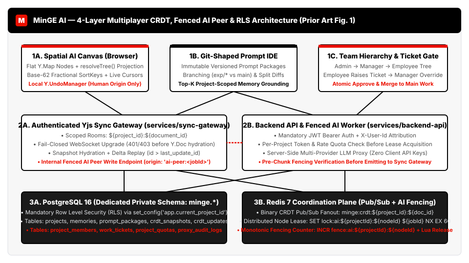
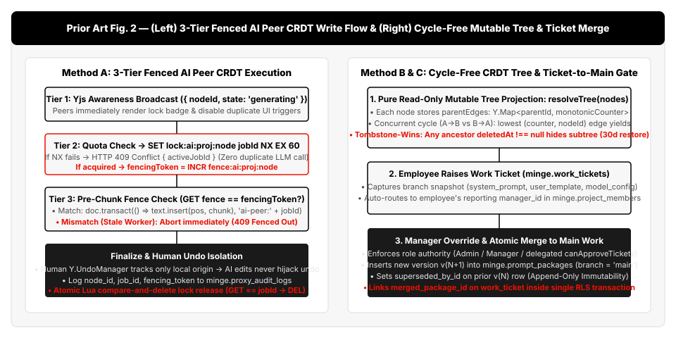

# MinGE AI — Enabling Technical Specification & Defensive Publication (`TECHNICAL_SPEC.md`)

**Publication Type**: Enabling Technical Disclosure & Defensive Prior Art Publication  
**Title**: System and Methods for Multi-Tenant Collaborative AI Workspaces Using Cycle-Free Flat-Map CRDT Projections, Monotonically Fenced AI Peer Transactions, Fail-Closed Row-Level-Secured Project Memory, and Hierarchical Role-Gated Prompt Promotion  
**Repository**: https://github.com/aayush223/Multiplayer-AI  
**Date of Disclosure**: November 2026  

---

## 1. Field of Invention & Problem Statement

Modern artificial intelligence workflows suffer from four structural failure modes when deployed across multi-user engineering and enterprise teams:

1. **Cross-Project Context Bleed**: Vector and conversational memory systems frequently share an unscoped or prompt-filtered index, causing proprietary facts, code snippets, or decisions from Project A to leak into LLM context windows assembled for Project B.
2. **CRDT Tree Corruption Under Concurrent Moves & Deletes**: Modeling hierarchical document or canvas trees in Conflict-Free Replicated Data Types (CRDTs) using nested `Y.Array` children duplicates nodes when two peers concurrently move the same node, creates infinite reactive write loops when peers attempt to repair concurrent `A -> B` and `B -> A` parent cycles, and permanently strips deletion actor/timestamp metadata when native CRDT `.delete()` operations are invoked.
3. **Concurrent AI Stream Clobbering & Human Undo Hijacking**: When multiple users trigger LLM completions on the same collaborative node, or when a network-stalled AI worker resumes after a newer generation has started, uncoordinated stream writes interleave and corrupt the shared document while polluting human clients' local `Y.UndoManager` stacks.
4. **Ungoverned Promotion to Production Prompts**: Existing prompt tools lack hierarchical organizational governance (`Admin -> Manager -> Employee`) that restricts direct production mutations while allowing managers to inspect, override, and atomically merge employee-submitted tickets into append-only production prompt packages.

This specification discloses an enabling, reproducible architecture and exact algorithms that solve all four problems.

---

## 2. System Architecture & Data Plane



The platform separates ephemeral real-time coordination, conflict-free replicated document state, and transactional relational persistence into four layers:

1. **Dual Client Surfaces (`apps/web`)**:
   - **Spatial AI Canvas**: Synchronous 2D node-graph surface bound to a live `Y.Doc`.
   - **Git-Shaped Prompt IDE**: Structured branch, diff, and evaluation workbench operating on immutable `minge.prompt_packages`.
   - **Team Hierarchy & Ticket Governance Surface**: Role-enforced control plane for organizational reporting lines, employee quotas/permissions, and Ticket-to-Main approvals.
2. **Authenticated Yjs Sync Gateway (`services/sync-gateway`)**:
   - Enforces a fail-closed WebSocket upgrade handshake on room `${project_id}:${document_id}`, verifying JWT Bearer tokens or SHA-256 Project Keys against PostgreSQL with transaction-local Row Level Security active *before* allocating or hydrating any `Y.Doc` in memory.
3. **Backend API, Quota Gate & Fenced AI Worker (`services/backend-api`)**:
   - Holds all upstream LLM provider keys server-side, enforces per-project token/rate quotas, acquires distributed Redis leases and monotonic fencing tokens, and streams fenced chunks into the Sync Gateway under attributed origin `'ai-peer:<jobId>'`.
4. **Storage & Coordination Plane (`PostgreSQL 16` + `Redis 7`)**:
   - All tables reside in dedicated private schema `minge` (never `public`) with mandatory `ENABLE ROW LEVEL SECURITY`.



---

## 3. Core Logic & Novel Methods (Step-by-Step Enabling Disclosure)

### Method A: Flat-Map Mutable Tree CRDT with Pure Deterministic Cycle Elimination and Tombstone-Wins Soft-Delete (`@minge/crdt-core`)

Instead of nested `Y.Array` child lists, every collaborative document stores a flat map `nodes: Y.Map<Y.Map>` keyed by immutable `nodeId`. Each node `Y.Map` contains:
- `id: string`
- `parentEdges: Y.Map<number>` (maps candidate `parentId -> monotonic integer counter`)
- `sortKey: string` (Base-62 fractional index with non-zero Base-61 `clientId` suffix)
- `content: Y.Text` (character-level CRDT sequence)
- `props: Y.Map<unknown>` (LWW atomic metadata)
- `deletedAt: number | null` and `deletedBy: string | null` (explicit soft-delete metadata; native `nodes.delete(id)` is strictly prohibited)

#### Step-by-Step Algorithm (`moveNode` & `resolveTree`):
1. **Reparenting (`moveNode`)**: To move node $u$ under parent $v$, the client reads the maximum counter currently stored in $u.\text{parentEdges}$, sets $c_{\text{next}} = \max(u.\text{parentEdges}) + 1$, and writes $u.\text{parentEdges.set}(v, c_{\text{next}})$ inside a Yjs transaction along with a new fractional `sortKey`.
2. **Candidate Sorting**: On every state change, each peer runs a pure, read-only projection function `resolveTree(nodesMap)`. For each node $u$, its candidate parent edges $(p, c)$ pointing to existing nodes (or `__ROOT__`) are sorted in descending order of $(c, p)$ using locale-independent code-point comparison. The active parent candidate index starts at $k_u = 0$.
3. **Deterministic Cycle Elimination**:
   - Traverse the functional directed graph defined by each node's current active edge $p = \text{candidates}_u[k_u].\text{parentId}$ in deterministic lexicographical `nodeId` order.
   - If a cycle $C = \{u_1, u_2, \dots, u_m\}$ is detected (e.g., Peer 1 moved $A \to B$ with counter $2$ while Peer 2 concurrently moved $B \to A$ with counter $2$), identify the weakest edge in $C$ defined as the node $u^* \in C$ minimizing the tuple $(\text{activeEdge}(u).\text{counter}, u.\text{id})$.
   - Increment $k_{u^*} \leftarrow k_{u^*} + 1$ so $u^*$ falls back to its next-highest historical parent edge in `parentEdges` (or `__ROOT__` if exhausted), and repeat until no cycles remain.
   - Because `resolveTree` never writes reactive mutations back into the `Y.Doc`, it cannot trigger network write storms, and all peers converge to a byte-identical acyclic tree regardless of update arrival order.
4. **Tombstone-Wins Subtree Hiding & 30-Day Recovery**:
   - After acyclic parent pointers are resolved, any node $u$ whose own `deletedAt !== null` OR whose resolved ancestor chain contains any node with `deletedAt !== null` is marked `effectivelyDeleted = true` and excluded from the active rendered tree.
   - Restoring a soft-deleted ancestor within the 30-day window (`now - deletedAt <= 30 days`) sets `deletedAt = null, deletedBy = null`, automatically restoring its entire descendant subtree intact.

---

### Method B: Base-62 Fractional Sibling Indexing with Non-Zero Base-61 Client Tie-Breakers

To order siblings under the same parent without array index shifts or concurrent key collisions:
1. Define ordered ASCII Base-62 alphabet $D = \text{"0123456789ABCDEFGHIJKLMNOPQRSTUVWXYZabcdefghijklmnopqrstuvwxyz"}$ and non-zero Base-61 sub-alphabet $D^+ = D[1..61]$ (`'1'..'z'`).
2. Given neighbor bounds `prevSortKey` ($a$) and `nextSortKey` ($b$) with $a < b$, compute the shortest base midpoint prefix $m = \text{midpoint}(a, b)$ in Base-62 such that $a < m < b$.
3. Encode the peer's numeric or FNV-1a hashed `clientId` into a non-empty Base-61 string $t \in (D^+)^+$ that never contains `'0'`, and emit $\text{sortKey} = m \parallel t$.
4. Because $t$ contains no `'0'` characters, no generated `sortKey` ever ends in `'0'`, mathematically guaranteeing that a valid midpoint always exists between any two distinct keys while ensuring concurrent insertions at identical `(prev, next)` bounds by different clients produce distinct, strictly bounded keys $a < m \parallel t_1 < m \parallel t_2 < b$.

---

### Method C: 3-Tier Concurrent AI Peer Locking with Monotonic Fencing Tokens and Undo Isolation

To allow server-side AI workers to stream tokens into a live `Y.Doc` concurrently with human editors without duplicate provider calls or stale-worker overwrites:
1. **Tier 1 (Ephemeral Awareness Guard)**: When a user initiates generation on `nodeId`, the client broadcasts `{ nodeId, state: 'generating', userId }` over Yjs Awareness so peer UIs immediately render a lock indicator.
2. **Tier 2 (Distributed Lease + Monotonic Fence)**:
   - The backend verifies JWT authentication, `X-User-Id` attribution, project membership, and project token/rate quotas (`minge.project_quotas` vs `minge.proxy_audit_logs`).
   - The backend executes `SET lock:ai:${projectId}:${nodeId} ${jobId} NX EX 60`. If `SET NX` fails, it returns `HTTP 409 Conflict` with `{ activeJobId }` so the second client attaches to the existing stream rather than invoking the LLM twice.
   - Upon acquiring the lease, the backend increments a monotonic fencing counter: `fencingToken = INCR fence:ai:${projectId}:${nodeId}`.
3. **Tier 3 (Pre-Chunk Fence Verification & Attributed Yjs Transaction)**:
   - Before writing *each* streamed token chunk, the AI worker verifies `GET fence:ai:${projectId}:${nodeId} == fencingToken`.
   - If the worker stalled past its 60-second lease TTL and a newer worker incremented the fence, the check fails and the stale worker immediately aborts (`409 Fenced Out`) before mutating the `Y.Doc`.
   - Validated chunks are applied to the node's `Y.Text` inside an attributed transaction:
     ```ts
     doc.transact(() => {
       contentText.insert(contentText.length, chunk);
     }, `ai-peer:${jobId}`);
     ```
   - Human clients configure `new Y.UndoManager(contentText, { trackedOrigins: new Set([localHumanOrigin]) })`, ensuring streamed AI edits merge seamlessly at the character level without entering or corrupting any human user's undo/redo stack.
   - On completion, the worker executes an atomic Lua compare-and-delete script (`if redis.call("get", KEYS[1]) == ARGV[1] then return redis.call("del", KEYS[1]) else return 0 end`) so an expired worker can never delete a newer worker's active lock.

---

### Method D: Fail-Closed Project Memory Isolation & Append-Only Superseding Lineage

1. **Query-Builder Fail-Closed Guard**: Every memory, prompt package, CRDT, and ticket query helper inspects `projectId` prior to checking out a database connection. If `projectId` is missing, empty, or whitespace, it throws `FAIL_CLOSED` immediately with zero database roundtrips.
2. **Transactional Parameterized RLS**: Every scoped query executes inside an explicit `BEGIN ... COMMIT` block calling parameterized `SELECT set_config('app.current_project_id', $1, true)` (and `set_config('app.current_user_id', $2, true)` for membership handshakes). All tables in schema `minge` enforce `CREATE POLICY ... USING (project_id = NULLIF(current_setting('app.current_project_id', true), '')::uuid)`.
3. **Append-Only Superseding Updates**: Updating a memory or prompt package never overwrites row content in place. Instead, a new row with `version = prior.version + 1` and `parent_id = prior.id` is inserted, and the prior row's `superseded_by_id` column is updated to point to the new row's UUID within the same transaction. Active retrieval queries filter `WHERE superseded_by_id IS NULL AND deleted_at IS NULL`.

---

### Method E: Hierarchical Role-Gated Ticket-to-Main Atomic Promotion

1. **Reporting Tree Authority**: Project members (`minge.project_members`) hold a role (`admin`, `manager`, `employee`), a reporting pointer `manager_id`, status (`active` | `paused`), and granular JSONB capabilities (`canEditMain`, `canApproveTickets`, `canManageTeam`, `canRunAi`, `dailyTokenCap`).
2. **Authority Predicate**: An actor $A$ can modify target member $T$ if and only if $A.\text{role} = \text{'admin'}$, or ($A.\text{role} = \text{'manager'}$ and $T.\text{role} \neq \text{'admin'}$ and ($T.\text{role} = \text{'employee'}$ or $T$ lies in the transitive reporting subtree of $A$)).
3. **Ticket Raise & Atomic Merge**:
   - Employees raise work tickets (`minge.work_tickets`) containing a proposed payload (`name`, `system_prompt`, `user_template`, `model_config`, `latest_output`) from an experimental branch or canvas node, automatically routed to `assigned_manager_id = actor.manager_id`.
   - When an authorized Manager or Admin invokes `decideTicket(action = 'approve_merge')` (optionally supplying an `overridePayload`), a single RLS-scoped PostgreSQL transaction:
     1. Selects the current active `main` branch `prompt_package` matching `name` (`superseded_by_id IS NULL AND deleted_at IS NULL`),
     2. Inserts a new immutable `minge.prompt_packages` row on `branch = 'main'` with `version = prior.version + 1` and `status = 'merged'`,
     3. Marks the prior `main` row `superseded_by_id = newPackage.id`, and
     4. Updates the ticket to `status = 'approved_merged'`, recording `reviewed_by_user_id`, `reviewed_at`, `review_note`, and `merged_package_id = newPackage.id`.

---

## 4. Disclosed Variations, Alternative Embodiments & Edge Cases (Defensive Scope)

To prevent third-party patent claims on trivial substitutions or obvious extensions of this architecture, this disclosure explicitly encompasses the following variations:

1. **Alternative CRDT Engines**: Implementing the flat-map `parentEdges` monotonic counter, deterministic `(counter, nodeId)` cycle-breaking projection (`resolveTree`), tombstone-wins soft-delete propagation, and `'ai-peer:<jobId>'` origin isolation on **Automerge**, **Loro**, **Diamond Types**, **Collabs**, or custom state/operation-based LWW-Element-Set and RGA/YATA sequence CRDTs.
2. **Alternative Distributed Lock & Fencing Backends**: Implementing Tier-2 and Tier-3 leases and monotonic fencing tokens using **PostgreSQL Advisory Locks + Sequences**, **etcd** (`Lease` + `ModRevision` / `CreateRevision`), **Apache ZooKeeper** (`zxid` / sequential ephemeral znodes), **Consul**, **DynamoDB** conditional writes with version attributes, or **Cloudflare Durable Objects**.
3. **Alternative Sibling Fractional Indexing Bases**: Using Base-10, Base-16, Base-36, Base-64, or variable-width byte-array lexicographical fractional indexing with deterministic peer/client/session ID tie-breaker suffixes or jittered midpoints.
4. **Multi-Stage & DAG Approval Hierarchies**: Extending the 3-tier (`Admin -> Manager -> Employee`) Ticket-to-Main approval gate to $N$-tier organizational hierarchies, quorum/multi-reviewer approvals, automated benchmark-gated approvals (auto-merging tickets when evaluation accuracy delta exceeds a threshold), or cross-department review chains.
5. **Multi-Modal & Multi-Agent Fenced Peers**: Applying fenced `'ai-peer:<jobId>'` CRDT transactions to concurrent code-execution sandboxes, image/audio/video generation nodes, tool-calling agent swarms, or RAG ingestion pipelines writing concurrently into shared spatial canvases or IDE documents.
6. **Alternative Tenant Isolation Mechanisms**: Enforcing fail-closed `project_id` memory isolation across **pgvector**, **Qdrant**, **Milvus**, **Pinecone**, **Weaviate**, **Chroma**, or **SQLite-vec** via per-tenant collections, cryptographic tenant key wrapping, or mandatory metadata pre-filters paired with relational RLS.
